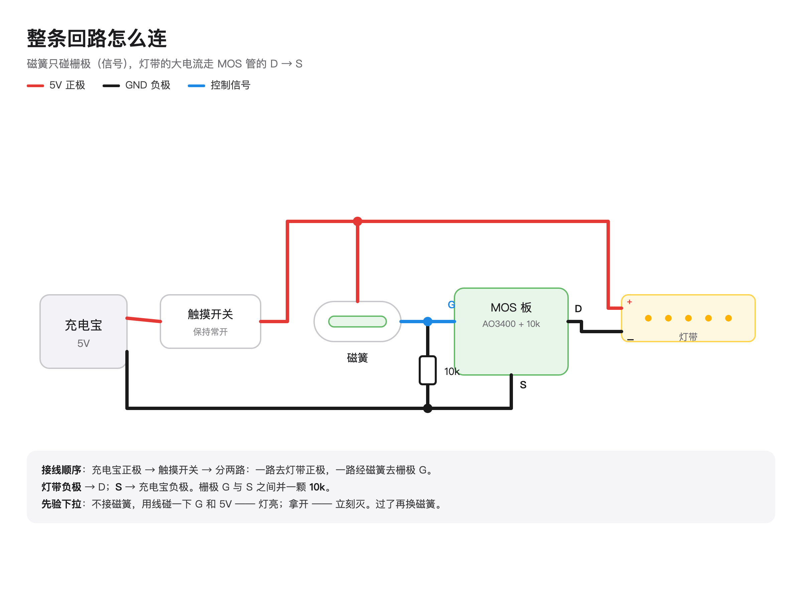
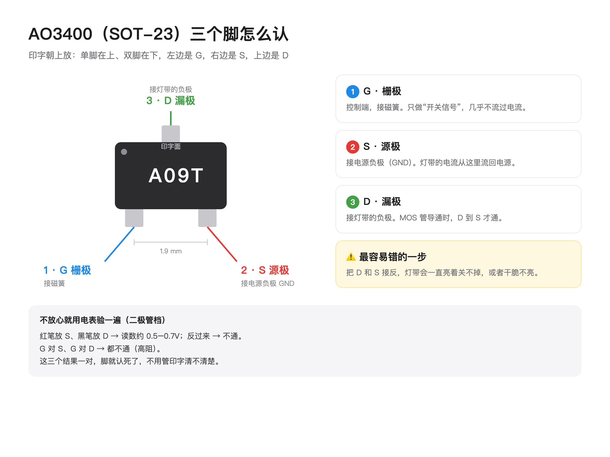
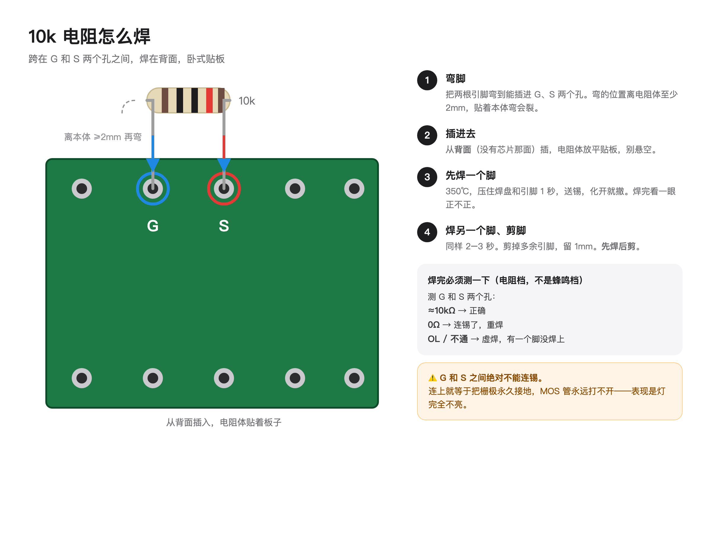

# 校服展示盒 · 磁铁触发灯光装置

> 把一枚冰箱贴贴到盒面的感应区，盒内的灯带亮起；拿走磁铁，灯灭。

一个为演唱会校服展示盒设计的低复杂度灯光改造方案。全部使用 5V 低压供电，不接入市电，不修改原灯带。

---

## 目录

- [背景](#背景)
- [交互设计](#交互设计)
- [工作原理](#工作原理)
- [硬件清单](#硬件清单)
- [关键细节](#关键细节)
- [制作步骤](#制作步骤)
- [实测数据](#实测数据)
- [待办](#待办)
- [安全](#安全)

---

## 背景

展示盒是单买的空盒，盒内没有任何电路。附赠一条 5V USB 灯带。目标是在不破坏盒子和灯带的前提下，增加一个"冰箱贴触发"的灯光效果。

设计约束：

- 只做一个，不考虑批量一致性；
- 逻辑尽量简单，不做延时、调光、多模式；
- 盒子平放展示，平时盖着收藏，展示时打开；
- 保留原灯带及其控制器。

## 交互设计

| 操作 | 结果 |
|---|---|
| 冰箱贴放到盒面感应区 | 灯带亮起 |
| 冰箱贴拿走 | 灯带立刻熄灭 |
| 合盖收藏（磁铁已取下） | 灯灭 |

**明确不做**：开盖联动、延时熄灭、多档调光、闪烁模式、联网控制。

## 工作原理

常开型磁簧开关串在"5V → MOSFET 栅极"之间。磁铁靠近时磁簧闭合，栅极被拉高，MOSFET 导通，灯带点亮；磁铁移开后磁簧断开，10k 下拉电阻把栅极拉回 0V，灯带熄灭。

灯带电流走 MOSFET 的 D→S，不经过磁簧。



## 硬件清单

| 元件 | 规格 | 数量 | 参考价 |
|---|---|---|---|
| 磁簧开关 | GPS-14A，常开，塑封，2.7×14mm | 1–10（挑选） | ~1.5 元/只 |
| 钕磁铁 | φ15×3，N35 | 2 | ~2 元/片 |
| MOSFET | AO3400（SOT-23，印字 A09T） | 1 | ~0.3 元 |
| 转接板 | SOT-23 转直插 | 1 | ~1 元 |
| 下拉电阻 | 10kΩ，1/4W | 1 | ~0.1 元 |
| 灯带 | 5V COB，2m，3000K，CRI≥90 | 1 | ~30 元 |
| 触摸开关 | 灯带自带，作为总开关 | 1 | 随灯带 |
| 电源 | 5V 充电宝 | 1 | 已有 |
| 保险丝 | 自恢复 PPTC，1.1A / 2A / 3A | 各 1 | ~2 元 |
| 接线端子 | WAGO 221-412 / 221-413 | 各 3 | ~10 元 |
| 导线 | 22AWG 硅胶线 | 若干 | ~10 元 |
| 热缩管 | 1–6mm 混装 | 若干 | ~10 元 |

## 关键细节

### 1. 磁簧的方向

磁簧开关对磁场方向敏感：玻璃管长轴**顺着磁力线**时最灵敏。冰箱贴的磁力线垂直于盒面，所以磁簧应尽量**垂直于盒面**安装。

如果只能平贴在背板上（横向切割磁力线），灵敏度会明显下降，需要用更强的磁铁补偿。

### 2. MOSFET 与 10k 下拉

AO3400 是 N 沟道 MOSFET，SOT-23 封装，引脚定义：



- 1 脚 = G（栅极）
- 2 脚 = S（源极）
- 3 脚 = D（漏极）

**10k 下拉电阻必须焊在 G 和 S 之间**。没有它，磁簧断开后栅极悬空，MOSFET 会保持导通，灯关不掉。



### 3. 灯带与电源

灯带是 5V COB，2 米，暖白 3000K，显色指数 ≥90。COB 没有颗粒感，适合展柜照明。

电源用 5V 充电宝，经灯带自带的触摸开关进入电路。触摸开关一直保持开启，只作为总开关使用；灯带的通断由磁簧控制。

### 4. 保险丝

灯带实际电流需要用万用表串联测量后确定：

| 实测电流 | 保险丝 |
|---|---|
| ≤ 0.8A | 1.1A |
| 1.2–1.7A | 2A |
| ≥ 1.8A | 3A |

保险丝串在 5V 正极上。

## 制作步骤

1. **焊接 MOSFET**：把 AO3400 焊到 SOT-23 转接板上。可用热风枪 + 锡膏（300℃，最小风量，10–20 秒），也可以用细尖烙铁逐脚焊接。
2. **焊 10k 下拉**：跨在 G 和 S 两个孔之间，焊在背面，电阻体贴板。
3. **引三根线**：从 G、S、D 三个孔各引一根 10cm 的 22AWG 线出来。
4. **验证开关**：不接灯带，用镊子把 G 碰一下 5V，万用表测 S–D 应导通；松开后应断开。若松开仍导通，说明 10k 没接好。
5. **接线**：灯带正极接 5V 节点，灯带负极接 D，S 接 GND，磁簧串在 5V 与 G 之间。
6. **手动测试**：不接磁簧，用线把 G 碰一下 5V，灯应亮；拿开应立刻灭。
7. **接磁簧**：磁铁靠近亮、拿走灭。
8. **量电流、装保险丝**。

## 实测数据

| 项目 | 结果 |
|---|---|
| G–S 电阻 | 10kΩ（下拉正常） |
| 手动碰 G 到 5V | 灯亮；拿开立刻灭 |
| 隔布 + 3mm 亚克力 | 有效，吸合距离约 2cm |
| 磁簧方向 | 待记录 |
| 灯带电流 | 待测量 |

> "约 2cm" 是隔着布料和 3mm 亚克力测得的吸合距离，具体叠层厚度仍需用实际盒子复核。

## 待办

- [ ] 用**现成冰箱贴**在真实叠层（面板 + 校服 + 背板）下测试是否触发
- [ ] 确认实际面板厚度、背板厚度、校服压缩后的厚度
- [ ] 测量灯带实际电流，选定保险丝并安装
- [ ] 确定磁簧最终安装位置（校徽背面 / 背板正面 / 背板挖槽）
- [ ] 确定磁铁规格：现成冰箱贴够用，还是定制内嵌 φ15 的校徽同款
- [ ] 盒面设计感应区对准标记（感应窗口约 2cm，需引导用户放准）
- [ ] 装配、走线、开合盖测试

## 安全

- 全程 5V 低压，不接入市电；
- 保险丝串在正极；
- 焊接后的裸引脚套热缩管；
- 焊锡含铅，操作后洗手，不在工作台进食；
- 钕磁铁分开平放，避免夹手和崩角。

---

## 文件说明

```
.
├── README.md                  # 本文档
├── EXPERIMENT.md              # 实验记录表（可打印填写）
└── images/
    ├── wiring.png             # 整条回路接线图
    ├── sot23-pinout.png       # AO3400 引脚识别
    └── pulldown-10k.png       # 10k 下拉电阻焊法
```
